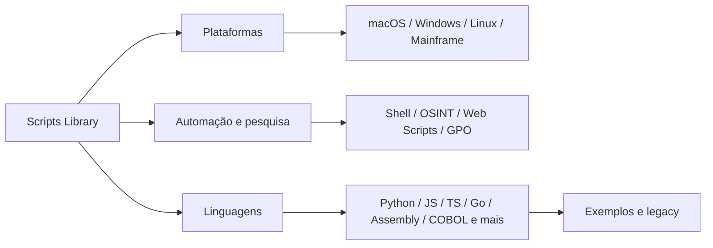

# 🧰 Scripts Library

**Automação • Sistemas • Linguagens • Web • OSINT • Mainframe**

Coleção organizada de exemplos, utilitários e estudos de programação.

 

[📚 Catálogo](./docs/CATALOG.md) · [🧭 Guia de uso](./docs/GETTING-STARTED.md) · [🛡️ Segurança](./docs/SAFETY.md) · [🤝 Contribuir](./docs/CONTRIBUTING.md)

---

## Visão geral

| Indicador | Quantidade |
| :-- | --: |
| Categorias documentadas | **23** |
| Arquivos históricos preservados | **25** |
| Exemplos introdutórios adicionados | **11** |

> **Transparência:** arquivos em `legacy/` foram preservados bit a bit, mas **não são certificados, revisados ou prontos para produção**. Há códigos incompletos e scripts capazes de alterar configurações. Leia [o aviso de segurança](./docs/SAFETY.md) antes de executar.

## Navegue por finalidade

### Plataformas

| Categoria | Categoria |
| :--- | :--- |
| [`macos/`](./macos/README.md) · Automação e inventário local em macOS | [`windows/`](./windows/README.md) · Scripts específicos de Windows |
| [`linux/`](./linux/README.md) · Scripts específicos de Linux | [`mainframe/`](./mainframe/README.md) · JCL e exemplos de ambiente z/OS |
| [`gpo/`](./gpo/README.md) · Inventário somente leitura de Group Policy |   |

### Automação, segurança e web

| Categoria | Categoria |
| :--- | :--- |
| [`shell/`](./shell/README.md) · Scripts Bash e operações de terminal | [`osint/`](./osint/README.md) · Processamento local e referências OSINT |
| [`web-scripts/`](./web-scripts/README.md) · Utilitários para conteúdo HTML e web |   |

### Linguagens

| Categoria | Categoria |
| :--- | :--- |
| [`python/`](./python/README.md) · Automação, análise e dados | [`typescript/`](./typescript/README.md) · Aplicações e scripts tipados |
| [`go/`](./go/README.md) · Exemplos na linguagem Go | [`javascript/`](./javascript/README.md) · Scripts Node.js e navegador |
| [`assembly/`](./assembly/README.md) · Experimentos em Assembly | [`cobol/`](./cobol/README.md) · COBOL e conceitos legados |
| [`c/`](./c/README.md) · Exemplos na linguagem C | [`csharp/`](./csharp/README.md) · Scripts e utilitários C# |
| [`java/`](./java/README.md) · Experimentos em Java | [`pascal/`](./pascal/README.md) · Experimentos em Pascal |
| [`php/`](./php/README.md) · Scripts na linguagem PHP | [`r/`](./r/README.md) · Experimentos em R |
| [`ruby/`](./ruby/README.md) · Experimentos em Ruby | [`swift/`](./swift/README.md) · Experimentos em Swift |
| [`sql/`](./sql/README.md) · SQL e experimentos com consultas |   |

## Como navegar

## Convenção do repositório

- `<categoria>/<exemplo>`: exemplo novo, autocontido e documentado (não necessariamente testado em todos os ambientes).
- `<categoria>/legacy/`: código original migrado **sem alterar conteúdo**, apenas caminho/nome.
- `docs/CATALOG.md`: inventário dos arquivos e indicação de maturidade.
- `docs/migration-map.json`: trilha verificável de origem e destino de cada arquivo original.

**Primeiros passos:** [guia de execução](./docs/GETTING-STARTED.md). Para alterações, abra um PR seguindo [CONTRIBUTING](./docs/CONTRIBUTING.md).

## O que este projeto é e não é

É um **repositório de estudos e utilitários**, incluindo exemplos educacionais e experimentais. **Não é** um pacote único executável, um framework OSINT integral, uma coleção de ferramentas homologadas nem garantia de compatibilidade ou precisão dos resultados.

> Use scripts somente em sistemas, dados e ambientes para os quais você tenha autorização. Não salve tokens, credenciais ou informações pessoais no repositório.
